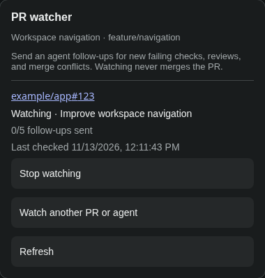
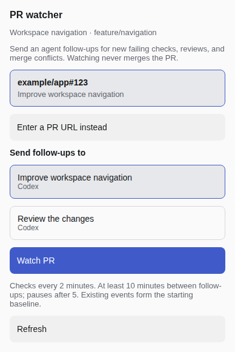

# Paseo PR watcher

An opt-in [Paseo](https://paseo.sh) plugin that watches a GitHub PR and sends its owning agent a follow-up when checks fail, a review arrives, or the PR develops a merge conflict.

## Setup

1. Run Paseo 0.16.0 beta 1 or newer within the 0.16 series on the daemon and app.
2. Install and authenticate `gh` on the daemon machine. The authenticated account needs read access to the PRs you watch.
3. Enable plugins on the target daemon in **Settings → Plugins → Enable plugins**. Plugins are trusted code that can access the daemon machine.
4. Install with `paseo plugin install git:508-dev/paseo-pr-watcher`. The daemon needs Node and npm on its command path; the manifest installs the locked SDK and validation dependencies with lifecycle scripts disabled.
5. Open **Watch PR** in the workspace header, or the pill above an agent's composer. On compact layouts, the header action is in the workspace's **···** menu.
6. Select the detected PR and the agent that should receive follow-ups, then choose **Watch PR**. The agent-tab pill preselects that agent; the workspace header defaults to the focused agent in that workspace, or its only agent. When neither applies, choose a recipient. If several PRs match, pick one. If none matches, enter a GitHub PR URL.
7. The control changes to **Watching #123**. Open it to see the recipient, last check, follow-up count, errors, and **Stop watching**. Paused or uncertain watches have their own labels and recovery actions. **Watched pull requests** in Command Center still lists every watch on this host.

The `/watch-pr https://github.com/owner/repo/pull/123` and `/watch-pr owner/repo#123` shortcuts remain available in agent chat.

The plugin does not merge PRs. It sends the agent a request to inspect and address actionable events. It treats the state at enrollment as a baseline, so existing failures do not trigger an immediate follow-up. It polls every two minutes, waits ten minutes between follow-ups, and pauses after five sends per watch. Remove and re-add a watch to begin a new cycle.

## UI previews

The actual popover rendered in Chromium with sample host data. These previews verify desktop dark and compact light layouts; they are not captures of the full Paseo app or physical mobile devices.




## PR detection

Discovery uses the workspace's actual checkout directory and current branch. It searches GitHub remotes and the parent repositories of forks, keeps PRs whose head repository matches a configured remote, and removes duplicates. A matching branch name in another contributor's fork is excluded. Multiple matches stay explicit choices. GitHub CLI access failures have a visible retry and a manual URL option; a detached HEAD uses manual entry.

The plugin rechecks the checkout branch and verifies that the recipient is still an active agent in this workspace before enrolling through the UI. A branch switch asks you to refresh. Existing watches keep their original PR and agent when you switch branches; they are never silently retargeted. The plugin watches PR events, not branch names.

## Delivery and storage

The plugin writes an atomic JSON state file at `$PASEO_HOME/plugins/pr-watcher-state.json`, falling back to `~/.paseo/plugins/pr-watcher-state.json` when `PASEO_HOME` is unset. Set `PASEO_PR_WATCHER_STATE_FILE` in the daemon environment to choose an explicit path. The file contains PR references, agent IDs, workspace IDs for UI-created watches, observed event IDs, and any follow-up awaiting delivery confirmation. It is created with owner-only permissions.

Paseo's `agent.send()` acknowledges daemon acceptance, not completion of the agent turn. The plugin records a pending send before calling it. If the call fails or the plugin restarts mid-send, it marks delivery **uncertain** and does not replay automatically. Check the agent chat, then select **Mark handled** or **Retry (may duplicate)** in the watch list.

The plugin's background poller gets its Paseo SDK session when an app connects or a plugin action runs. After a daemon restart with no app client connected, polling resumes on the next client connection. A future core SDK change could provide an always-available plugin session and remove this limitation.

## Development

```sh
npm ci --include=dev --legacy-peer-deps --ignore-scripts
npm run typecheck
npm run lint
npm run format:check
npm test
```

The plugin uses the published `@getpaseo/plugin` 0.16 beta contract. Tests use fake GitHub snapshots and a temporary state file; they do not call GitHub or a running Paseo daemon.

Licensed under AGPL-3.0-only.
